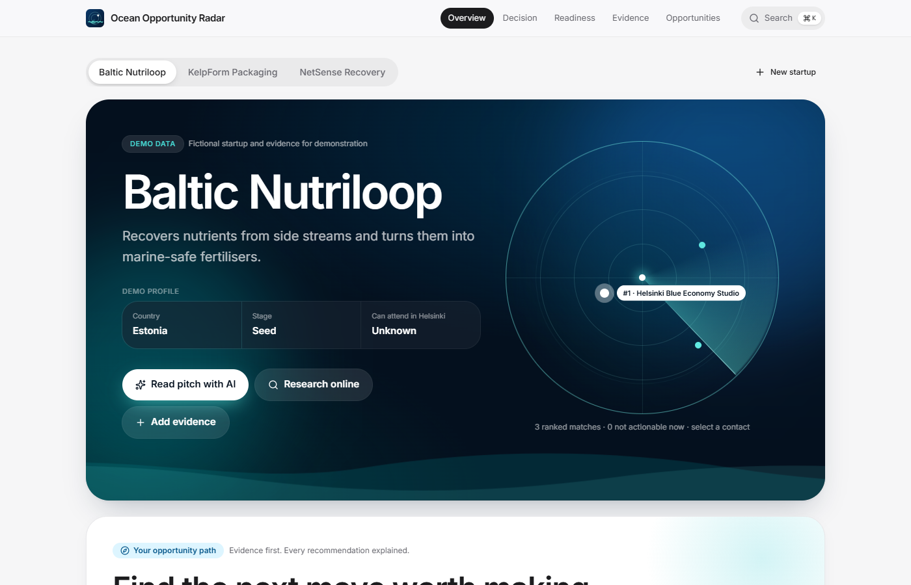
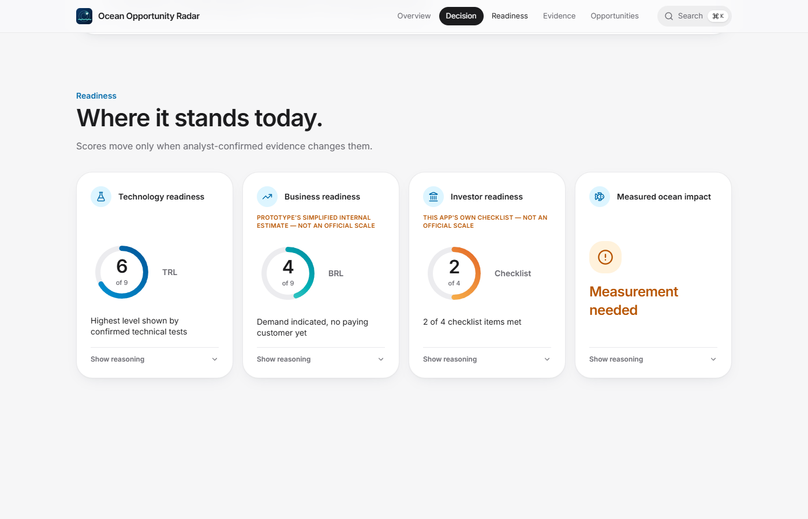
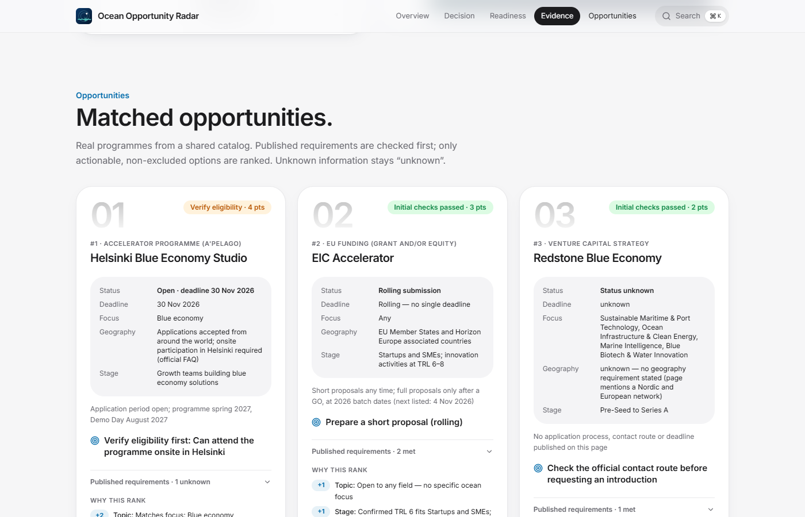
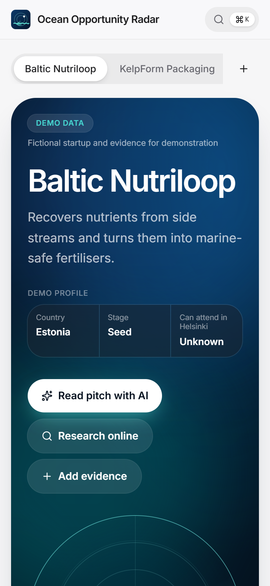

<div align="center">

# 🌊 Ocean Opportunity Radar

Hi! This is my hackathon project for the **A’Pelago / Redstone** challenge.
It helps people at ocean funds and accelerators decide what to do next with a startup, and every answer has a source you can check.

[](https://ocean-opportunity-radar.kirills-portfolio.workers.dev/)




</div>

## The idea

When you work at a fund or an accelerator, you look at a lot of ocean startups. For each one you have to figure out:
how ready is it, which programme or investor fits it, and what should I ask the founders for next.

The problem is that AI tools are fast but they often make things up. So I wanted to build something where
**AI can help you find information, but it can never change a score by itself.** A person checks the evidence first,
and only then the decision changes. And the app always shows why.

## How it works

1. **Pick a startup** or add your own. There are 3 example startups (made up, for the demo).
2. **Read the pitch with AI.** You paste a pitch and the AI pulls out claims, with the exact quote from the text.
   All of them start as "not confirmed".
3. **Research online.** It can look up a real startup on the web and give you a short summary with links to the sources.
4. **Check the evidence.** You look at the proof, write what you checked and confirm it. Only now the scores move.
5. **See what changed and why.** For example, after a paid pilot is confirmed, the best match for Baltic Nutriloop
   switches from Helsinki Blue Economy Studio to Redstone, and the app explains which rule made that happen.

## Screenshots

<table>
  <tr>
    <td width="50%"></td>
    <td width="50%"></td>
  </tr>
  <tr>
    <td><b>Readiness.</b> Tech readiness (TRL), business readiness, an investor checklist and ocean impact. They only change when confirmed evidence changes them.</td>
    <td><b>Opportunities.</b> Real programmes and investors with links to their official pages. If something isn't known, it just says "unknown".</td>
  </tr>
</table>

<p align="center"><br/><sub>It works on phones too</sub></p>

## Things I cared about

- **AI never decides alone.** AI suggestions stay "not confirmed" until a person checks them.
- **No made up numbers.** If the app doesn't know something, it says "unknown" instead of guessing.
- **Our rules vs official rules.** When something is our own preference (like "a paying customer first"), the app
  says so, so it never looks like an official requirement.
- **The quotes have to be real.** When the AI quotes a pitch, the quote must actually be in the text, or it gets rejected.
- **Your API key stays on the server**, never in the browser.

## What I used

- React, TypeScript, TanStack Start, Tailwind
- OpenAI API (structured outputs and web search)
- Vitest for tests
- Cloudflare Workers for hosting

## Run it yourself

You need Node.js 22+.

```bash
npm ci
npm run dev
```

The AI features need an OpenAI key. Put `OPENAI_API_KEY=...` in `.env.local` and restart the dev server.
Without a key the app still works, only the AI buttons show an error.

```bash
npm test          # tests
npx tsc --noEmit  # type check
npm run build     # production build
```

## Honest notes

- The 3 startups in the demo are made up.
- The catalog only has 3 real opportunities for now, and only some of their conditions. Always check the official pages.
- Business readiness and the investor checklist are my own simple estimates, not official scales.

More details are in [docs/VERIFICATION.md](docs/VERIFICATION.md) and [docs/ROADMAP.md](docs/ROADMAP.md).

---

Made by [Kirill](https://github.com/Ar7ti) · Feel free to try it and tell me what you think 👇
[LinkedIn](https://www.linkedin.com/in/kirill-jegosin-807199412/)
